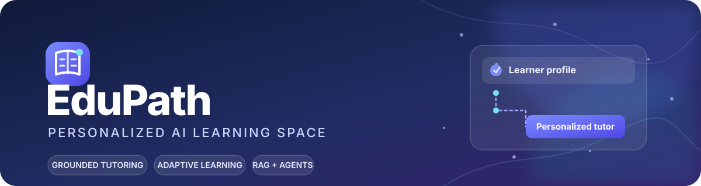
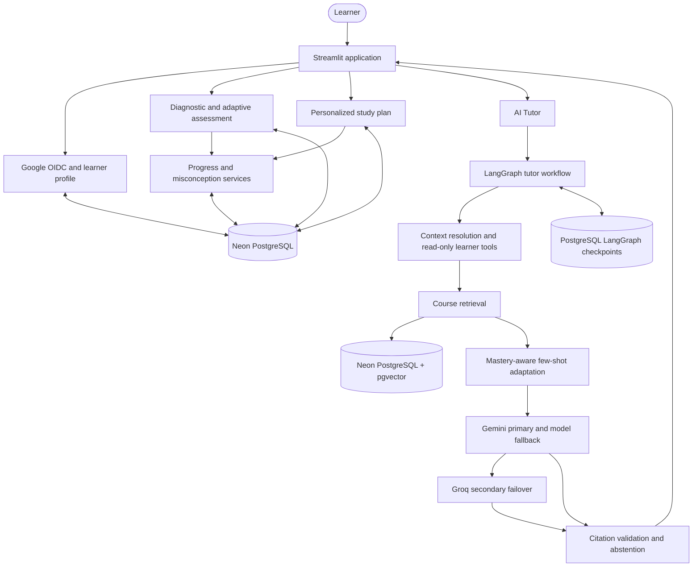

<div align="center">

<a href="https://edupath-perla-demo.streamlit.app/">
  
</a>

### A personalized, evidence-grounded Python learning companion

Learner-aware tutoring · Adaptive practice · RAG · Persistent learning progress

[](https://edupath-perla-demo.streamlit.app/)
[](https://github.com/ManikantaPerla07/EduPath/tree/feature/unify-langchain-retrieval)

[](https://www.python.org/)
[](https://streamlit.io/)
[](https://www.langchain.com/)
[](https://www.langchain.com/langgraph)
[](https://ai.google.dev/)
[](https://groq.com/)
[](https://neon.tech/)
[](https://github.com/pgvector/pgvector)
[](https://github.com/ManikantaPerla07/EduPath/stargazers)
[](https://github.com/ManikantaPerla07/EduPath/commits/feature/unify-langchain-retrieval)

</div>

---

## What is EduPath?

**EduPath** is a personalized AI tutoring platform currently focused on beginner Python programming. It combines a source-grounded AI tutor with diagnostic assessment, adaptive practice, learner progress analytics, and prerequisite-aware study planning.

Instead of giving every learner the same explanation, EduPath uses learner preferences and assessment evidence to adapt teaching depth, identify misconceptions, and recommend what to study next.

> **Design principle:** personalize the learning journey, and make factual explanations traceable to approved course material.

## At a glance

| 9 Python topics | 27-question diagnostic bank | 3 teaching levels | Persistent learning history |
|:---:|:---:|:---:|:---:|
| Beginner curriculum | Easy / medium / hard | Beginner / intermediate / advanced | Chats, progress and plans |

## Feature highlights

### Personalized learning
- **Learner profile:** save proficiency, preferred explanation style, language, learning goal, and daily study availability.
- **Diagnostic assessment:** establish a baseline across nine Python topics using a 27-question bank.
- **Adaptive practice and targeted revision:** deliver one question at a time, provide immediate feedback, and focus practice on weaker topics.
- **Progress and mastery tracking:** monitor attempts, accuracy, and topic-level learning status.
- **Personalized study plans:** schedule learning, practice, revision, and spaced review around prerequisites, goals, and available time.

### Grounded, agentic AI tutor
- **RAG with pgvector:** retrieve relevant course chunks from Neon PostgreSQL before answer generation.
- **Source-linked answers:** attach citations to retrieved material and validate citation IDs against sources available for the response.
- **Evidence-aware abstention:** return an insufficient-evidence response when course material cannot support an answer.
- **Few-shot teaching adaptation:** adjust explanation depth and examples across beginner, intermediate, and advanced levels.
- **LangGraph orchestration:** resolve follow-up context, route learner-specific questions to read-only progress and study-plan tools, retrieve course evidence, and generate responses.
- **Model resilience:** Gemini is the primary generation provider; model fallback and Groq provide secondary paths for eligible transient failures. Provider attribution is surfaced in the application.

### Memory and knowledge management
- **Persistent conversations:** store chat history and LangGraph checkpoints in Neon PostgreSQL.
- **Misconception tracking:** record learner-specific misconceptions to guide revision.
- **Answer feedback:** learners can rate tutor responses; feedback is stored with the associated answer.
- **Admin Knowledge Management:** upload PDF, TXT, and Markdown resources; map them to topics; inspect extraction, chunking, and embedding status; retry processing; archive resources; and publish after topic-coverage checks.
- **Aggregate insights:** administrators can review course-level feedback and tutor-run summaries without exposing learner conversation text.

## How the learner journey works

1. **Sign in and set preferences** — choose learning level, explanation style, goals, and daily study time.
2. **Take the diagnostic** — progress across the Python curriculum.
3. **Review progress** — see attempts, accuracy, and topic mastery evidence.
4. **Follow a study plan** — work through prerequisite-aware learning, practice, and revision.
5. **Ask the AI Tutor** — get an explanation grounded in approved course resources, adapted to learner level, with citations where available.
6. **Practice and improve** — use feedback and misconception tracking to guide the next learning cycle.

## Architecture

EduPath is a modular Python application. Streamlit provides learner and administrator interfaces; Python services own deterministic grading, authorization, persistence, and planning; LangGraph coordinates the tutoring workflow.



## Retrieval evaluation

The repository includes a repeatable **18-query golden benchmark**: two queries for each Python topic. The evaluator searches the whole published course and checks whether retrieved chunks match the expected topic metadata.

| Metric | Recorded result |
|---|---:|
| Queries evaluated | 18 |
| Queries returning results | 18 / 18 |
| Retrieval coverage | **100.0%** |
| Mean Reciprocal Rank (MRR) | **0.963** |
| Hit@1 | **94.4%** |
| Hit@3 / Hit@5 | **100.0% / 100.0%** |

**Interpretation:** relevance is defined by a retrieved chunk's topic slug matching the query's expected topic. This is a small retrieval-alignment benchmark; it does **not** measure answer factuality, citation faithfulness, teaching quality, or learner outcomes. See [evaluation methodology](docs/EVALUATION.md) and the [machine-readable report](retrieval-evaluation.json).

### Automated tests

The latest local regression run reported **639 tests passing** (0 failures) on November 18, 2026. This is a local test result—not a hosted CI badge.

```powershell
python -m unittest discover -s tests -p "test_*.py"
python -m compileall -q app.py ui services agents tests
git diff --check
```

## Technology stack

| Layer | Technology |
|---|---|
| Application / UI | Python 3.11, Streamlit |
| LLM orchestration | LangChain, LangGraph |
| Primary generation | Google Gemini |
| Secondary generation | Groq |
| Embeddings | Gemini Embedding 2 (768 dimensions) |
| Retrieval | RAG, cosine similarity, PostgreSQL pgvector |
| Persistence | Neon PostgreSQL, LangGraph PostgreSQL checkpointer |
| Authentication | Google OpenID Connect via Streamlit authentication |
| Document processing | pypdf, LangChain loaders and text splitters |
| Testing | Python unittest suite, pytest-compatible test project |
| Hosting | Streamlit Community Cloud |

## Live application

**Try EduPath:** [https://edupath-perla-demo.streamlit.app/](https://edupath-perla-demo.streamlit.app/)

The hosted app uses Streamlit Community Cloud, Google sign-in, Neon PostgreSQL, and configured Gemini/Groq credentials. Access may depend on the app's sharing settings and provider free-tier quotas.

## Run locally

### Prerequisites

- Python 3.11 and Git
- PostgreSQL with the `pgvector` extension (Neon is used by the hosted project)
- Google Gemini API key and Google OAuth/OIDC credentials
- Groq API key for secondary-provider failover (optional but recommended)

### 1. Clone the current implementation branch

```powershell
git clone --branch feature/unify-langchain-retrieval --single-branch https://github.com/ManikantaPerla07/EduPath.git
cd EduPath
```

### 2. Create an environment and install dependencies

```powershell
python -m venv .venv
.venv\Scripts\Activate.ps1
python -m pip install --upgrade pip
python -m pip install -r requirements-dev.txt
```

### 3. Configure local secrets

```powershell
Copy-Item .streamlit\secrets.toml.example .streamlit\secrets.toml
```

Edit `.streamlit/secrets.toml` with your own values:

```toml
DATABASE_URL = "YOUR_NEON_POSTGRESQL_CONNECTION_STRING"
GEMINI_API_KEY = "YOUR_GEMINI_API_KEY"
GROQ_API_KEY = "YOUR_GROQ_API_KEY"

[auth]
redirect_uri = "http://localhost:8501/oauth2callback"
cookie_secret = "GENERATE_A_RANDOM_SECRET"
client_id = "YOUR_GOOGLE_OAUTH_CLIENT_ID"
client_secret = "YOUR_GOOGLE_OAUTH_CLIENT_SECRET"
server_metadata_url = "https://accounts.google.com/.well-known/openid-configuration"
```

Generate a cookie secret:

```powershell
python -c "import secrets; print(secrets.token_urlsafe(32))"
```

Add `http://localhost:8501/oauth2callback` to the Google OAuth client's authorized redirect URIs.

**Never commit `.streamlit/secrets.toml` or share populated credentials.** The real secrets file is excluded by `.gitignore`; only the placeholder example belongs in Git.

### 4. Initialize a development database

Use a dedicated development database—not the production database used by the live demo.

```powershell
python database\run_migrations.py
python database\seed_course.py
python database\seed_questions.py
```

The course seed starts unpublished. An administrator must review and process approved topic resources through **Knowledge Management**, generate embeddings, verify topic coverage, and explicitly publish the course before learners can access it.

### 5. Start EduPath

```powershell
python -m streamlit run app.py
```

Open [http://localhost:8501](http://localhost:8501).

## Repository structure

```text
EduPath/
├── agents/                 # LangGraph tutor workflow and learner tools
├── database/               # PostgreSQL migrations and seed scripts
├── demonstrations/         # Multi-level few-shot teaching demo
├── docs/                   # Product, architecture, security and user docs
├── evaluation/              # Golden queries and retrieval evaluator
├── experiments/             # Academic practicals and safety evaluation
├── interview_preparation/  # Viva and technical interview preparation
├── rag/                     # Retrieval-related modules
├── sample_documents/        # Original Python learning notes
├── services/                # Domain, persistence, retrieval and LLM services
├── tests/                   # Automated tests
├── ui/                      # Learner and administrator interfaces
├── .streamlit/              # Streamlit config and secrets example
├── app.py
├── requirements.txt
└── requirements-dev.txt
```

## Security and responsible AI

- **Explicit AI opt-in:** consent defaults to `false`; tutor and subjective AI evaluation calls are gated by the learner's stored consent.
- **Adult self-confirmation:** designed for adult learners and requires an affirmative 18+ self-confirmation; this is not third-party age verification.
- **Learner-scoped access:** service-layer authorization uses authenticated learner identity and ownership-scoped database operations. Native PostgreSQL Row-Level Security (RLS) is **not** currently configured.
- **No server-side code execution:** learner-submitted Python code is not executed by the application.
- **Evidence controls:** retrieved content is treated as reference data, citation IDs are validated, and the tutor can abstain when evidence is mandatory.
- **Provider transparency:** Gemini and Groq have separate data-handling terms. After consent, learner prompts and relevant conversational or learning context may be sent to the selected provider. Do not enter passwords, API keys, or sensitive personal information.

Read [Security and Privacy](docs/SECURITY.md) before deploying your own instance.

## Documentation

| Guide | What it covers |
|---|---|
| [Product Requirements](docs/PRD.md) | Product vision, learner needs and scope |
| [System Architecture](docs/ARCHITECTURE.md) | Application layers, LangGraph and persistence |
| [API & Workflows](docs/API_AND_WORKFLOWS.md) | Service interfaces and end-to-end flows |
| [Database Design](docs/DATABASE.md) | PostgreSQL schema and relationships |
| [Security & Privacy](docs/SECURITY.md) | Consent, authorization and data handling |
| [Evaluation](docs/EVALUATION.md) | Retrieval metrics and evaluation limitations |
| [Experiments](docs/EXPERIMENTS.md) | Academic practicals and implementation notes |
| [Deployment](docs/DEPLOYMENT.md) | Streamlit Cloud and Neon configuration |
| [User Guide](docs/USER_GUIDE.md) | Learner and administrator workflows |
| [Pre-deployment Checklist](docs/PRE_DEPLOYMENT_CHECKLIST.md) | Release readiness and operational checks |

## Scope and roadmap

**Current scope:** one beginner Python course with nine topics, a 27-question diagnostic bank, learner profiles, adaptive practice, evidence-grounded tutoring, study planning, progress tracking, and administrator-managed learning resources.

**Future directions:** additional courses, richer instructor workflows, voice-enabled tutoring, collaborative study features, and broader answer-quality evaluation.

## About

**EduPath** is a CSE473 academic major project built by **Perla Manikanta**.

- **GitHub:** [@ManikantaPerla07](https://github.com/ManikantaPerla07)
- **Repository:** [ManikantaPerla07/EduPath](https://github.com/ManikantaPerla07/EduPath)
- **Live app:** [edupath-perla-demo.streamlit.app](https://edupath-perla-demo.streamlit.app/)

---

<div align="center">

**Learn with evidence. Improve with feedback. Progress with a plan.**

If EduPath is useful, consider giving the repository a ⭐.

</div>
