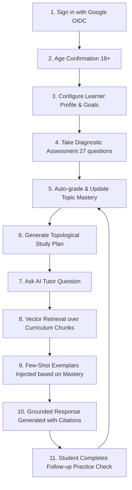
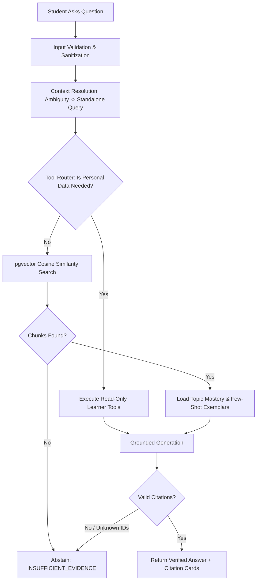

# API & Workflows Documentation — EduPath
**System:** EduPath — Personalized Tutoring Agent\
**Academic Project:** CSE473 Major Project\
**Author:** Perla Manikanta

---

## 1. Service Layer API Reference

### 1.1 Learner Service (`services/learner_service.py`)
- `get_or_create_learner(claims: Mapping) -> dict`: Resolves or creates a user and profile row using Google OIDC identity claims.
- `confirm_adult_status(user_id: str) -> None`: Sets `adult_confirmation = True` in transactional isolation.
- `get_learner_profile(user_id: str) -> dict`: Retrieves comprehensive profile attributes including learning goals.
- `update_learner_profile(user_id: str, ...) -> dict`: Server-side validated update for proficiency, style, and study target.

### 1.2 Assessment & Grading Services
- `start_assessment(user_id, course_slug, assessment_type, ...) -> dict`: Initializes an assessment session snapshotting questions from `question_bank`.
- `submit_assessment(user_id, assessment_id, answers) -> dict`: Deterministically grades multiple-choice answers, writes responses, computes overall score, and triggers `refresh_learner_topic_progress`.
- `submit_adaptive_answer(user_id, assessment_id, item_id, answer) -> dict`: Grades a single answer in an adaptive session and returns the next dynamic question calibrated to performance.

### 1.3 Progress & Adaptation Services
- `calculate_topic_progress(total_attempts, correct_answers) -> dict`: Computes accuracy and mastery score, applying the evidence damping factor: $\text{factor} = \min(\text{attempts}/5, 1.0)$.
- `get_learner_teaching_profile(user_id, course_slug, retrieved_chunks) -> dict`: Derives the appropriate teaching strategy and few-shot exemplar bundle for the highest-ranked retrieved topic.

### 1.4 Curriculum & Study Plan Service
- `generate_study_plan(user_id, course_slug, days, daily_minutes) -> dict`: Runs topological sort over the prerequisite graph, prioritizing weak topics (`needs_revision` $\to$ `developing` $\to$ `not_assessed`), distributing activities across the schedule.

### 1.5 Retrieval & Answer Generation Services
- `retrieve_course_chunks(query, course_slug, topic_slug, limit) -> list[dict]`: LangChain retriever adapter executing cosine vector similarity search over `document_chunks`.
- `generate_grounded_answer(question, retrieved_chunks, teaching_guidance, learner_context) -> dict`: Formulates grounded Gemini prompts, enforces citation anchors `[S1]`, rejects ungrounded claims, and handles abstention.

---

## 2. Primary End-to-End Workflows

### 2.1 The Complete Learner Journey Workflow

### 2.2 Tutor Conversational Cycle

