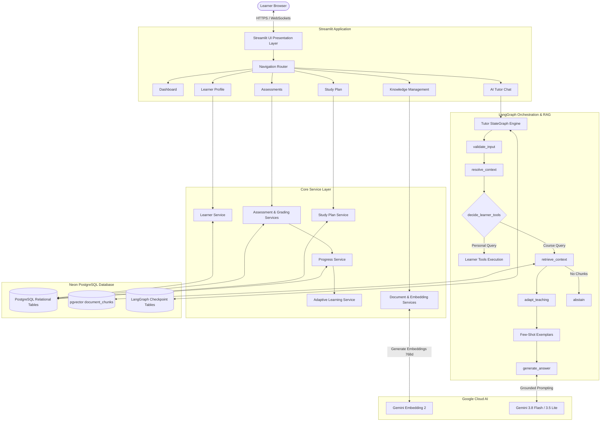
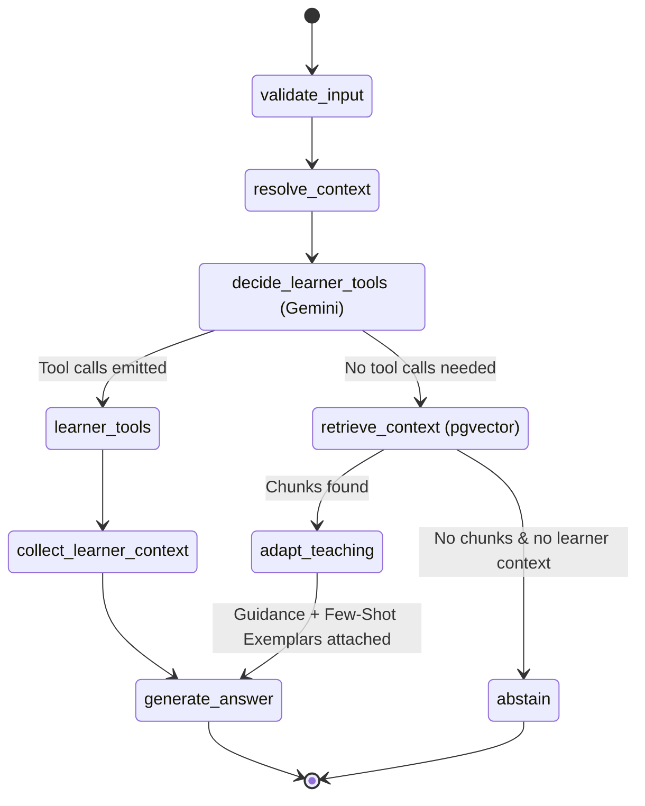
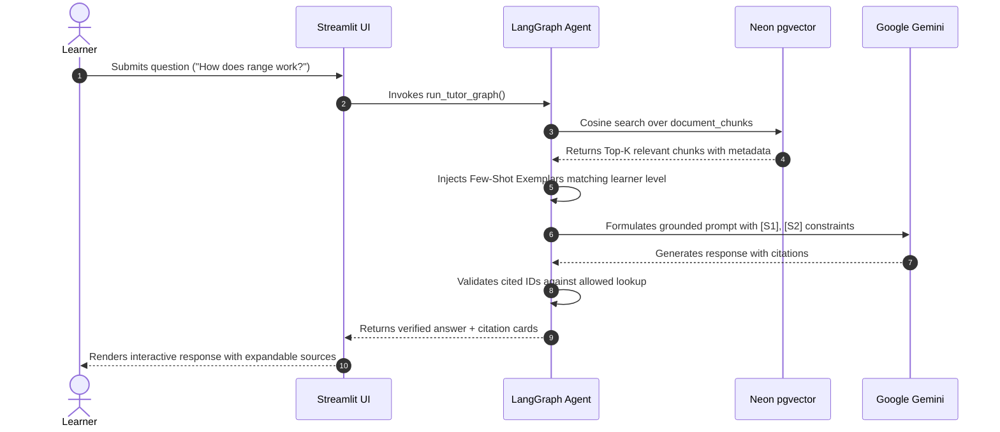

# System Architecture & Technical Design — EduPath
**System:** EduPath — Personalized Tutoring Agent\
**Academic Project:** CSE473 Major Project\
**Author:** Perla Manikanta

---

## 1. High-Level Architectural Overview
EduPath is structured as a **modular Python monolith**. It avoids unnecessary microservice complexity, API gateways, or dual-language runtimes, adhering strictly to the project's **₹0 budget principle**.

---

## 2. LangGraph StateGraph Workflow
The tutoring conversation is orchestrated via a stateful `StateGraph` in `agents/tutor_graph.py`:

### Node Responsibilities:
1. `validate_input`: Verifies length ($L \le 2000$), presence of non-empty text, and sanitizes strings.
2. `resolve_context`: Uses recent conversation history to convert ambiguous follow-ups (e.g. *"Can you give an example of that?"*) into standalone search queries.
3. `decide_learner_tools`: Binds read-only tools (`get_my_learning_progress`, `get_my_study_plan`) and lets Gemini route personal questions.
4. `retrieve_context`: Queries `document_chunks` via `NeonPgVectorRetriever` using cosine distance (`<=>`).
5. `adapt_teaching`: Inspects learner topic progress and injects targeted few-shot exemplars from `services/few_shot_prompting_service.py`.
6. `generate_answer`: Executes grounded prompt template with citation parser `[S1]`, `[S2]`.
7. `abstain`: Returns safe fallback `INSUFFICIENT_EVIDENCE` when evidence is missing.

---

## 3. Memory Architecture
EduPath maintains two strictly decoupled memory tiers:
1. **Short-Term Conversational Memory:**
   - Thread checkpoints managed by `langgraph-checkpoint-postgres` in `checkpoints` and `checkpoint_writes` tables.
   - Allows multi-turn conversation restoration across browser refreshes.
2. **Long-Term Learner Knowledge State:**
   - Authoritative relational schema in Neon PostgreSQL:
     - `learner_profiles`: Learning goals, proficiency tier, daily schedule.
     - `learner_topic_progress`: Historical attempts, correct answers, accuracy, mastery scores.
     - `study_plans` & `study_plan_items`: Sequenced learning activities.
     - `chat_messages`: Persisted learner and assistant transcripts with citation metadata.

---

## 4. Grounded RAG Pipeline Architecture

