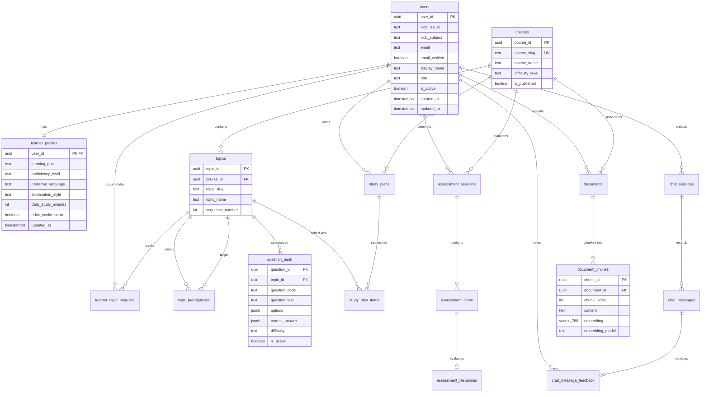

# Database Documentation & Data Architecture — EduPath
**Database Engine:** Neon Serverless PostgreSQL\
**Database Name:** `neondb`\
**Vector Extension:** `pgvector` (0.8.6)\
**Academic Project:** CSE473 Major Project\
**Author:** Perla Manikanta

---

## 1. Entity-Relationship (ER) Diagram
The diagram reflects the exact relational and vector schema defined across migrations `001` through `006`:

---

## 2. Core Relational Tables & Descriptions

### 2.1 Identity and Profiles
- `users`: Stores verified Google OIDC identity claims (`oidc_issuer`, `oidc_subject`), role (`student` or `admin`), and active account status.
- `learner_profiles`: Stores student learning preferences (`proficiency_level`, `preferred_language`, `explanation_style`, `daily_study_minutes`, `learning_goal`, `adult_confirmation`).

### 2.2 Curriculum & Prerequisites
- `courses`: Master course table (e.g., `python-basics`). Contains publication flag (`is_published`).
- `topics`: 9 sequential course topics with ordered `sequence_number`.
- `topic_prerequisites`: Directed Acyclic Graph (DAG) mapping prerequisite dependencies between topics.

### 2.3 Assessment Engine
- `question_bank`: Seeded bank of 27 verified Python questions with JSONB options, answer keys, explanations, and difficulty ratings.
- `assessment_sessions`: Student assessment attempt metadata (`diagnostic`, `practice`, `revision`), status (`in_progress`, `submitted`), and overall score percent.
- `assessment_items`: Session-specific question snapshot instances preventing changes to past records if the question bank updates.
- `assessment_responses`: Graded student answers, correctness boolean, awarded points, and explanations.

### 2.4 Progress and Study Plans
- `learner_topic_progress`: Aggregated performance per student per topic: attempts, correct answers, accuracy percentage, mastery score, and status (`not_assessed`, `needs_revision`, `developing`, `candidate_for_mastery`).
- `study_plans` & `study_plan_items`: Personalized curriculum schedules generated by topological sort over weak prerequisite areas.

### 2.5 Vector Knowledge Base
- `documents`: Registry of uploaded curriculum notes and textbooks with SHA-256 duplicate detection and licensing metadata.
- `document_chunks`: Extracted text chunks with Gemini Embedding 2 vectors (`vector(768)`). Includes `idx_document_chunks_document_id` index.

---

## 3. Migration History Summary
1. `001_initial_schema.sql`: Core schema (users, profiles, courses, topics, assessments, chat, document registry, telemetry).
2. `002_question_bank_key.sql`: Unique constraint on `question_code` for reliable seeding and idempotent verification.
3. `003_document_chunks.sql`: Added `document_chunks` table with `vector(768)` column for pgvector similarity search.
4. `004_document_archival.sql`: Added `archived_at` column and partial index for non-destructive document retirement.
5. `005_chat_message_feedback.sql`: Added `chat_message_feedback` table for student ratings (thumbs up/down).
6. `006_chat_and_tutor_run_indexes.sql`: Optimized partial indexes for active agent runs and user question limits.
